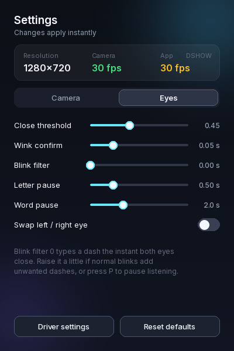
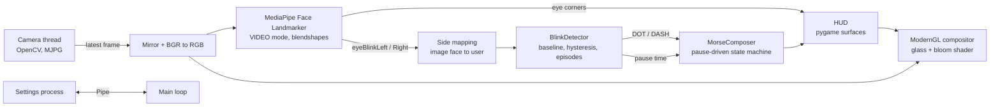

# Arm Morse

Type Morse code with your forearms in front of a webcam. Put **both hands together** to switch typing on or off. Then each forearm fires a gesture the moment it points into a zone: the **left forearm** up for a dash, down for a dot; the **right forearm** up to end the letter, down to add a space. The app reads the arms with MediaPipe Pose and draws the arm bones and both hand skeletons (MediaPipe Hands) on the camera image.

---

## Quick start

### 1. Requirements

| | |
|---|---|
| Python | 3.10, 3.11 or 3.12 (MediaPipe does not always support the newest Python right away) |
| Webcam | Any USB, built-in or phone camera. 30 FPS or more is recommended |
| GPU | Anything that supports OpenGL 3.3 (every integrated GPU from the last ten years) |
| OS | Windows 10/11 (main target), macOS and Linux also work |

### 2. Install

**Windows (PowerShell)**

```powershell
cd AI_computer_vision_morse_coding
python -m venv .venv
.venv\Scripts\Activate.ps1
python -m pip install --upgrade pip
pip install -r requirements.txt
```

**macOS / Linux**

```bash
cd AI_computer_vision_morse_coding
python3 -m venv .venv
source .venv/bin/activate
python -m pip install --upgrade pip
pip install -r requirements.txt
```

> The project uses **pygame-ce**, a maintained fork of pygame. If the classic `pygame` package is already installed in the same environment, remove it first with `pip uninstall pygame`, because both packages provide the `pygame` module.

### 3. Run

```bash
python main.py
```

On the first launch the pose model (`pose_landmarker_lite.task`, about 5.5 MB) is downloaded into `models/` (the hand model `hand_landmarker.task` is already there, or is downloaded too). Later launches work offline.

### 4. Run the tests (optional)

```bash
python -m unittest discover -s tests -v
```

The tests cover the Morse logic, the blink detector and the left/right eye mapping. They do not need a camera.

---

## How to use it

Stand or sit so that both **shoulders, elbows and wrists** are in view.

**Switch typing on / off: both hands together.** Bring your hands together (palms touching, wrists closer than 0.35 x your shoulder width) for about 0.15 s. The hand skeletons flash amber and the bottom strip shows `on` or `off`. Move the hands apart before the next switch. Nothing is typed while the hands are together.

**Angles.** The angle is the forearm vector (elbow to wrist) against the screen's X axis: right = 0°, up = 90°, down = -90°. The right arm's angle is mirrored, so for both arms +45° means "hand raised diagonally towards the body" and level towards the body is 0°.

| Arm | Angle enters | Result |
|---|---|---|
| **Left forearm** | 35° to 145° (up) | Dash `-` |
| **Left forearm** | -135° to -35° (down) | Dot `.` |
| **Right forearm** | 35° to 145° (up) | End of letter: the code becomes a letter |
| **Right forearm** | -135° to -35° (down) | Space (ends the letter first if one is open) |

**Instant zones.** The first frame inside a zone fires the gesture, with no hold time, so fast movements are caught. That arm is then marked as detected and fires nothing more until it leaves the zone (by more than the *exit margin*, 5° by default, so tracking noise at the edge cannot fire twice). It does not have to return to level: going straight from the up zone to the down zone fires both. If an arm is already in a zone when typing is switched on, it fires only after leaving and coming back.

**Feedback.** A forearm turns amber while it is in a zone that has already fired, and flashes thicker when its gesture fires. Press **H** to show each forearm's angle next to the elbow with the zone name (`dash`, `dot`, `end`, `space`), plus `ok` once it has fired. The bottom strip shows the code typed so far, the letter it decodes to (or the letters still reachable), the message, and the switch state. The Morse chart in the top-right corner dims letters the current code can no longer reach.

**Example: typing "HI"**

1. Put both hands together. The strip shows `on`.
2. Flick the left forearm down and back out of the dot zone, four times (`....`).
3. Right forearm up, then back down to level. **H** is added.
4. Two more flicks down with the left arm (`..`), then right forearm up. **I** is added.
5. Right forearm down. A space is added.
6. Hands together again to switch typing off.

**Swap roles.** Press **S** (or *Dot / dash arm* in the Arm settings tab) to type dots and dashes with the right arm and end letters / add spaces with the left. The choice is saved.

Press **P** to pause typing while you rest, or **Z** to hide the interface and stop input completely. Deleting is done on the keyboard.

### Keyboard shortcuts

| Key | Action |
|---|---|
| `S` | Swap roles: which arm types dots and dashes, which ends letters and adds spaces |
| `X` | Open or close the settings window |
| `Z` | Hide or show the interface. Hidden = normal camera colours and no typing |
| `P` | Pause or resume typing |
| `H` | Show or hide the forearm angle next to each elbow (with the zone it is in: dash, dot, end, space, level) |
| `C` | Show or hide the Morse chart |
| `M` | Mute or unmute sounds |
| `Backspace` | Delete the last symbol, or the last letter if no symbol is pending |
| `Delete` | Clear everything |
| `Esc` / `Q` | Quit |

### Settings window



Press `X` to open it. It has two tabs. Changes apply instantly and are saved to `settings.json` when the app closes.

**Camera tab**
- Live stats: the real capture resolution, camera FPS and app FPS. Green is 30 FPS or more, amber is 15 to 30, red is below 15.
- Device number, with the device name underneath on Windows (for example "Integrated Webcam" or "Camo"), resolution, target FPS (30 or 60), mirror view, auto exposure, and manual exposure, brightness, contrast and gain.
- **Driver settings** (Windows) opens the camera maker's own settings dialog.

**Arm tab**
- **Exit margin**: how far past the edge of a zone an arm must go before it can fire again (default 5°). The zones themselves (`dash_min`, `dash_max`, `dot_min`, `dot_max`) are in `settings.json`.
- **Hands together**: how close the wrists must be, as a fraction of shoulder width (default 0.35).
- **Dot / dash arm (S)**: which arm types dots and dashes. The other one ends letters and adds spaces.
- **Swap left / right arm**: for cameras or phone apps that already mirror the image.

A card under the controls lists every gesture with the current angles.

### Using an iPhone or Android phone as the camera

A phone camera is usually much sharper than a laptop webcam, and sharper eyes make blinks easier to read. Install a "phone as webcam" app such as Camo, iVCam or EpocCam on both the phone and the PC, connect the phone by USB, and the phone shows up as an extra camera. In the settings window, step **Device** to the new camera (its name is shown on Windows). Put the phone at eye level and light your face from the front.

### Troubleshooting

**Black screen or 0 camera FPS.** The app tries several capture modes in turn (DirectShow with MJPG, DirectShow with the driver's own format, 30 fps, the driver's default size, then Media Foundation). A mode that hangs for 3 s or sends only black frames for 2.5 s is skipped, and the one that works is remembered in `settings.json` (`mode_hint`). The mode in use is shown under the title of the settings window. Virtual cameras such as Camo send black frames or nothing at all while the phone is not connected in the Camo app.

**Exposure / brightness / contrast / gain show "n/a".** The camera driver does not offer that control (virtual cameras like Camo have none of them). Change the picture in the camera's own app instead.

| Problem | Fix |
|---|---|
| "Camera unavailable" | Close other apps using the camera (Teams, Zoom, OBS), or pick another device in the settings window. |
| FPS below 15 | Choose 640×480 in settings, turn off auto exposure in a dark room (long exposure halves the frame rate), and plug the laptop in. |
| Blinks are missed | Lower **Close threshold** a little. Good, even lighting on the face helps most. |
| Quick blinks come out as dashes | Raise **Time unit t**. |
| Letters or words end before you are done | Raise **Time unit t**. |
| Typing feels slow | Lower **Time unit t**. |
| Normal blinks add symbols | Press **P** while resting, or **Z** to switch input off. |
| Input feels slow | Choose 60 FPS in settings. At 30 FPS each frame is 33 ms apart, at 60 FPS only 17 ms. |
| Left and right are swapped | Turn on **Swap left / right eye**. |
| Glasses | Usually fine. Strong reflections on the lenses can hide the eyelids, so tilt the screen or the light slightly. |
| Model download fails | Download the file from the URL in `blink_morse/config.py` and save it as `models/face_landmarker.task`. |

---

## Tech stack

| Part | Library | Why |
|---|---|---|
| Face tracking | [MediaPipe Face Landmarker](https://ai.google.dev/edge/mediapipe/solutions/vision/face_landmarker) | 478 face points plus 52 expression scores, including one blink score per eye, in real time on a normal CPU |
| Camera | [OpenCV](https://opencv.org/) | Reads the webcam and controls exposure, brightness and so on |
| Window and input | [pygame-ce](https://pyga.me/) | Window, keyboard, text rendering and sound playback |
| Rendering | [ModernGL](https://github.com/moderngl/moderngl) (OpenGL 3.3) | Draws the frosted glass panels and the neon glow on the graphics card |
| Maths | [NumPy](https://numpy.org/) | Signal maths and sound synthesis |
| Camera names | [pygrabber](https://github.com/andreaschiavinato/python_grabber) (Windows, optional) | Lists DirectShow device names for the settings window |
| Fonts | Inter and JetBrains Mono | Bundled in `assets/fonts` under the SIL Open Font License |

No sound files and no image assets are shipped: every sound is synthesised at start-up and every shape is drawn in code.

---

## How it works (non-technical overview)

Think of the app as a small assembly line with five stations.

1. **The camera takes pictures.** About 30 to 60 times a second, the webcam sends a new picture of you.

2. **The body and hand readers find your arms.** Two pre-trained models from Google find your elbows and wrists, and the 21 points of each hand. Each hand is matched to the nearest wrist, so the app always knows which hand is the right one.

3. **The switch decides if you are typing.** Putting both hands together (wrists close compared with shoulder width) flips typing on or off.

4. **The angle reader turns poses into keys.** For each forearm it measures the angle against the X axis (mirrored for the right arm). The moment the angle enters a zone, that is a gesture; the arm has to leave the zone before it can fire again. Left arm: up = dash, down = dot. Right arm: up = end the letter, down = space. When a letter ends, the dots and dashes are looked up in the international Morse table; a code that does not exist is shown as "no match" instead of a guess.

5. **The screen shows the result.** The camera keeps its normal colours. Thin bones and hand skeletons show what the app sees, the Morse chart sits in the corner, and the code and message are in a small strip at the bottom. A short sound confirms every symbol, so you can type without looking.

The app never records or uploads anything. Every picture is processed in memory and thrown away straight after.

## How it works (technical deep dive)

### Pipeline



### Threads and processes

- **Camera thread** (`camera.py`) blocks on `VideoCapture.read()` and publishes only the newest frame through a `threading.Condition`. The main loop wakes up as soon as a frame arrives and never processes the same frame twice. `CAP_PROP_BUFFERSIZE = 1` and MJPG are requested so frames are fresh and 720p can still reach 30 to 60 FPS. On Windows the backends are tried in the order DirectShow, Media Foundation, default, which also covers virtual cameras created by phone-webcam apps.
- **Main thread** runs detection, the blink detector, HUD drawing and the OpenGL composition, in that order. The symbol and its sound are produced before any texture upload or drawing, so rendering never adds to the reaction time.
- **Settings process** (`settings_window.py`). The main window owns an OpenGL context, and a second SDL window in the same process can steal or invalidate it. Running the settings UI in a `spawn` child process avoids that and keeps slider dragging from stalling the render loop. Messages are small tuples over a `multiprocessing.Pipe`.

### Signal: blendshapes and side mapping (`face_tracker.py`)

The Face Landmarker runs in `VIDEO` mode with `output_face_blendshapes=True`. Of the 52 ARKit-style blendshapes, `eyeBlinkLeft` and `eyeBlinkRight` are used. They respond to true lid closure much better than an eye-aspect-ratio computed from the mesh, whose eyelid points tend not to close fully.

MediaPipe names both landmarks and blendshapes after the face **as depicted in the image** (see [google-ai-edge/mediapipe#6368](https://github.com/google-ai-edge/mediapipe/issues/6368)). Mirroring the frame therefore swaps them: in the default selfie view, `eyeBlinkLeft` is the user's right eye. `build_result()` applies that swap once, so every other module only sees the user's own left and right. A unit test pins this down.

### Blink detector (`blinks.py`)

**Per-user baseline.** `EyeSignal` tracks the lower envelope of each raw score while the eye is open (it falls quickly, with a 0.25 s time constant, and rises slowly, with 2 s), capped at 0.4. The normalised closure is `(raw - baseline) / (1 - baseline)`. This matters for people with narrower eyes and for laptop cameras, where looking down at the screen lowers the lids and raises the resting score.

**Hysteresis.** An eye becomes closed above `close_threshold` (0.45) and opens again below `close_threshold - 0.15`.

**Pose per frame.** `open`, `left`, `right` or `both`. Only `both` counts as a blink; winks are ignored.

**Blink timing.** A blink starts on the first frame both eyes are closed. It ends when the eyes have looked open for two frames in a row (so one noisy frame cannot split a blink in two), and its end time is the first of those open frames. With time unit `t`:

| Situation | Result | When |
|---|---|---|
| Blink still closed after 1.5 t | `DASH` | at 1.5 t, eyes still closed |
| Blink ended before 1.5 t | `DOT` | when the eyes open |

The dash is emitted as soon as it can be told apart from a dot, which removes the wait for the eyes to open. The 1.5 t split point sits halfway between the "shorter than t" and "longer than 2 t" rule of thumb, so there is no dead zone where a blink types nothing.

The detector also reports `closed_time` (for the live dot-to-dash preview) and `pause_time`: seconds since the eyes opened after the last blink, which the composer uses for the letter and word gaps. Calling `reset(now)` restarts that clock; the app does this when the interface is shown again with Z, so time spent hidden never counts as a pause.

### Morse state machine (`morse.py`)

`MorseComposer` knows nothing about cameras, so it can be tested with plain function calls. It is driven by symbols and by the idle time reported every frame:

| State | Input | Result |
|---|---|---|
| any | dot / dash | append to `code`, cancel a pending space |
| `code` not empty | idle ≥ `letter_gap` (3 t) | decode, `LETTER` (arms the space) or `INVALID` |
| space armed | idle ≥ `word_gap` (7 t) | `SPACE` (never leading, never doubled) |
| `code` already 6 symbols long | dot / dash | `INVALID` right away, since no code is longer |
| any | Backspace | remove last symbol, otherwise last character |

Both gaps are measured from the same moment, so a new symbol typed between 3 t and 7 t simply continues the same word. The table follows ITU-R M.1677-1 for A to Z, 0 to 9 and common punctuation.

### Rendering (`compositor.py` and `hud.py`)

The camera and the UI layer are uploaded as two textures and one small shader puts the UI on top. The camera keeps its own colours: no grading, dimming, blur or vignette. A cover crop (like CSS `object-fit: cover`) fills the 800×600 window at any camera aspect ratio without stretching.

The HUD is drawn with pygame on a transparent surface. Bones and hand skeletons are thin off-white lines with a 1 px dark outline so they stay visible on light and dark backgrounds; all outlines are drawn before the colours so joints stay clean. Text sits on a flat dark backdrop. Amber is the only accent colour.

### Audio (`audio.py`)

Tones are built with NumPy: a sine wave plus a soft second harmonic and a short attack and release to avoid clicks. The dash lasts three times as long as the dot, as in real Morse timing. The mixer is opened with a 256-sample buffer (about 6 ms) so the sound follows the blink closely.

### Performance budget

On the CPU side (camera upload, HUD drawing, layer upload) a frame takes about 10 ms. The Face Landmarker with blendshapes adds roughly 8 to 20 ms depending on the CPU, which keeps the app between 30 and 60 FPS on a typical laptop. VSync is off so the camera sets the pace and no extra frame of latency is added.

End-to-end, a dash is typed one camera frame plus one detection after the blink reaches 1.5 t, and a dot two frames after the eyes open (the second frame confirms they really are open).

---

## Project structure

```
AI_computer_vision_morse_coding/
├── main.py                  entry point
├── requirements.txt
├── blink_morse/
│   ├── app.py               main loop, wires everything together
│   ├── config.py            constants, colours, saved settings
│   ├── camera.py            threaded webcam reader
│   ├── arm_tracker.py       MediaPipe Pose wrapper, forearm angle, arm mapping
│   ├── arm_gestures.py      forearm angle zones, hands-together switch
│   ├── curls.py             old curl detector (no longer used by the app)
│   ├── hand_tracker.py      MediaPipe Hands wrapper, hand-to-arm matching
│   ├── face_tracker.py      old face input (no longer used by the app)
│   ├── blinks.py            old blink detector (no longer used by the app)
│   ├── morse.py             Morse table and composer state machine
│   ├── hud.py               everything drawn on top of the camera
│   ├── draw.py              anti-aliased shapes
│   ├── compositor.py        ModernGL shader: camera + UI layer
│   ├── audio.py             synthesised feedback sounds
│   └── settings_window.py   settings window (separate process)
├── assets/fonts/            Inter and JetBrains Mono (OFL)
├── models/                  pose model, downloaded on first run
├── docs/                    screenshots for this README
└── tests/                   unit tests for Morse logic and blinks
```

## Credits

- Pose and face tracking models: Google MediaPipe, Apache License 2.0.
- Fonts: Inter by Rasmus Andersson and JetBrains Mono by JetBrains, both under the SIL Open Font License 1.1 (licence files in `assets/fonts`).
