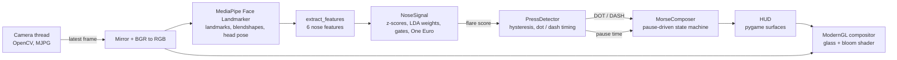

# Nose Morse

Type Morse code by flaring your nostrils in front of a webcam. A short flare is a dot, a long flare is a dash, and keeping the nose relaxed ends a letter or a word. Everything is timed in one adjustable unit t, and the decoded text appears on screen as you type.

No single camera measurement of a nostril flare is reliable, so the app measures six features of the nose and learns, in a 10-second guided calibration, how much each one is worth for your face, your camera and your light.

---

## Quick start

### 1. Requirements

| | |
|---|---|
| Python | 3.10, 3.11 or 3.12 (MediaPipe does not always support the newest Python right away) |
| Webcam | Any USB, built-in or phone camera. 30 FPS or more is recommended |
| GPU | Anything that supports OpenGL 3.3 (every integrated GPU from the last ten years) |
| OS | Windows 10/11 (main target), macOS and Linux also work |

### 2. Install

**Windows (PowerShell)**

```powershell
cd AI_computer_vision_morse_coding
python -m venv .venv
.venv\Scripts\Activate.ps1
python -m pip install --upgrade pip
pip install -r requirements.txt
```

**macOS / Linux**

```bash
cd AI_computer_vision_morse_coding
python3 -m venv .venv
source .venv/bin/activate
python -m pip install --upgrade pip
pip install -r requirements.txt
```

The project uses pygame-ce, a maintained fork of pygame. If the classic `pygame` package is installed in the same environment, remove it first with `pip uninstall pygame`, because both packages provide the `pygame` module.

### 3. Run

```bash
python main.py
```

On the first launch the face tracking model (`face_landmarker.task`, about 3.7 MB) is downloaded into `models/`. Later launches work offline.

### 4. Run the tests (optional)

```bash
python -m unittest discover -s tests -v
```

The tests cover the Morse logic, the nose feature fusion, the press detector and the old blink detector. They do not need a camera.

---

## How to use it

### Calibration (about 10 seconds)

Calibration starts by itself when the app opens, and again whenever you press C. A prompt at the top of the screen tells you what to do:

1. "Relax your nose" for 2 s.
2. "Flare your nostrils" for 1.5 s, then "Relax your nose" for 1.5 s. This is repeated three times.

Keep your head still and do not smile during calibration. Flare the way you will flare when typing. When it finishes, the Nose flare panel shows the result:

| Label | Meaning |
|---|---|
| good (d' 3 or more) | Rest and flare are clearly apart. Typing should be reliable |
| weak (d' 1.5 to 3) | It works, but expect some missed or extra symbols. Try more light or a bigger flare, then press C |
| poor (d' under 1.5) | Hard to tell apart. Move closer to the camera, improve the light, press C |
| default weights | No flare was seen during calibration. Press C and try again |

d' is the distance between "relaxed" and "flared" measured in units of the resting noise.

### Typing

All timings come from one time unit t (0.25 s by default, adjustable in the settings window):

| Nose | Result | With t = 0.25 s |
|---|---|---|
| Short flare, shorter than 1.5 t | Dot `·` | under 0.375 s |
| Long flare, 1.5 t or longer | Dash `–` | 0.375 s or more |
| Relaxed for 3 t | End of letter | 0.75 s |
| Relaxed for 7 t | End of word, a space is added | 1.75 s |

A dash is typed the moment the flare reaches 1.5 t, while your nostrils are still flared. A dot can only be known once the nose relaxes.

The readout next to your nose and the Nose flare bar show the flare score: 0 % is your relaxed nose, 100 % is your average flare from calibration. The white tick on the bar is the threshold (50 % by default), the faint tick is 100 %. The readout lights up cyan while the flare would be a dot and violet once it has become a dash.

Smiling, opening the mouth or turning the head also changes the shape of the nose, so the app ignores the nose while any of these happen. The status line under the title says why ("Smiling, nose ignored", "Face the camera").

Example, typing "SOS": three short flares, relax 1 s, three long flares, relax 1 s, three short flares.

### Face mesh panel (debug)

The top-left panel redraws the tracked face from its 478 landmarks: the face outline in bold, the inner mesh at 20 % opacity, and both nostril areas in bold. The nostril fill gets stronger as the flare score rises, and the nostrils glow in the dot or dash colour while a flare is being typed. If the mesh shakes while your face is still, the landmarks are noisy and the flare score will be too.

Next to the mesh:

- Yaw: how far the head is turned left or right, as seen on screen.
- Pitch: how far the head is tilted up or down.
- "Δ calib": the difference from the pose saved at calibration. It turns amber when it passes the limit shown at the top right (±20° for yaw, ±12° for pitch); past that limit the nose is ignored.

Press G to show the timing legend in this panel instead.

### Keyboard shortcuts

| Key | Action |
|---|---|
| `C` | Calibrate again |
| `X` | Open or close the settings window |
| `Z` | Hide or show the interface. Hidden = normal camera colours and no typing |
| `P` | Pause or resume listening |
| `H` | Show or hide the Morse chart |
| `F` | Show the feature panel: each feature's share of the flare score and its live z-score |
| `G` | Switch the top-left panel between the face mesh and the timing legend |
| `L` | Start or stop recording features to `logs/nose_*.csv` |
| `N` (hold) | While recording, marks the frames where you are flaring (the `label` column) |
| `M` | Mute or unmute sounds |
| `Backspace` | Delete the last symbol, or the last letter if no symbol is pending |
| `Delete` | Clear everything |
| `Esc` / `Q` | Quit |

### Settings window

Press X to open it. Changes apply instantly and are saved to `settings.json` when the app closes.

Camera tab: device, resolution, FPS, mirror, exposure, brightness, contrast, gain, and (on Windows) the camera driver's own dialog.

Nose tab:

- Flare threshold: how big a flare must be to count, as a share of your average calibration flare. Lower it if short flares are missed, raise it if symbols appear on their own.
- Time unit t: the base timing, from 0.05 to 0.6 s. A card below spells out what every rule means in seconds.
- Smile gate: above this `mouthSmile` value the nose is ignored.
- Use nostril darkness: turn it off when the camera cannot see your nostrils. The weights are refitted from the saved calibration frames, no new calibration needed.
- Calibrate again: same as the C key.

### Tips for a good signal

- Put the camera at nose height or a little lower, so it looks slightly up at the nostrils. A phone through Camo, iVCam or EpocCam is much sharper than most laptop webcams.
- Light the face from the front. Shadows from the side change the nose shape from frame to frame.
- Sit close enough that your face fills about a third of the picture. The nose is small; more pixels on it means less noise.
- Choose 60 FPS if the camera supports it.

### Troubleshooting

| Problem | Fix |
|---|---|
| Calibration says "default weights" or "poor" | More light, move closer, flare harder during the prompts, press C |
| Short flares are missed | Lower Flare threshold, or flare a little longer |
| Short flares come out as dashes | Raise Time unit t |
| Symbols appear on their own | Raise Flare threshold, keep the head still, press C to recalibrate |
| "Smiling, nose ignored" while not smiling | Raise Smile gate |
| "nose re-centred" pops up | The score stayed high for 4 s, so the resting level was reset. If it happens often, recalibrate |
| Letters end before you are done | Raise Time unit t |
| "Camera unavailable" | Close other apps using the camera, or pick another device in settings |
| FPS below 15 | Choose 640×480, turn off auto exposure in a dark room, plug the laptop in |

---

## How it works

### Pipeline



### Features (`nose.py`)

| Feature | What it measures |
|---|---|
| `wing` | Distance between landmarks 129 and 358 (outer nose wings) |
| `alar` | Distance between landmarks 48 and 278 |
| `base` | Distance between landmarks 64 and 294 (alar base) |
| `lower` | Distance between landmarks 98 and 327 (lower nostril edge) |
| `sneer` | Mean of the `noseSneerLeft` and `noseSneerRight` blendshapes |
| `dark` | Weighted darkness of the nostril openings in a face-aligned patch under the nose |

The four distances are divided by the distance between the inner eye corners (133 and 362), so moving closer to the camera does not change them, and turning the head shrinks both by about the same factor.

For `dark`, a patch from one alar base to the other is cut out under the nose tip and scaled by the nose width. Each pixel's darkness is `(skin - L) / skin`, where L is its lightness and `skin` the lightness of the nose bridge (landmarks 5 and 195) in the same frame. The darkness is averaged with two soft round weights placed where the nostrils sit. A continuous value is used instead of counting pixels under a fixed threshold, because a count jumps from frame to frame near the threshold.

### Fusion: linear discriminant from the calibration

From the calibration frames (the first 0.45 s of every step is dropped for reaction time):

1. Each feature is standardised with its resting mean and noise: `z = (x - mean_rest) / std_rest`.
2. `d` = mean z while flaring, per feature.
3. `C` = covariance of z at rest, shrunk 30 % towards the identity because the four distances come from the same mesh and are correlated.
4. Weights `w = C⁻¹ d` (Fisher's linear discriminant), divided by `d · C⁻¹ d` so the average calibration flare scores exactly 1.
5. Quality `d' = sqrt(d · C⁻¹ d)`.

A feature that does not react for a given person gets a weight near zero, so nothing has to be tuned by hand. The F panel shows each feature's share of an average flare, `w × d`, which adds up to 100 %. If calibration sees no flare (d' under 0.8), a fallback uses the mean z of the four distances and `sneer`, with a flare assumed at 3 standard deviations.

### Running signal

Each frame the score is `Σ w·z`, smoothed with a One Euro filter (min cutoff 2.5 Hz, beta 0.5), which smooths hard when the score is steady and lets fast changes through. The score is forced to 0 when `mouthSmile` is above the smile gate, `jawOpen` is above 0.45, or the head is more than 12° (pitch) or 20° (yaw) away from the calibrated pose.

While the score is under 0.2, the resting means follow slow changes with a 6 s time constant, and with 20 s while it is between 0.2 and 90 % of the threshold, so a small posture change cannot hold the score just under the threshold. A score above the threshold for 4 s is not real typing, so the resting means are re-centred on the current values.

### Press detector (`press.py`)

The nose counts as pressed above the threshold and released below `max(threshold - 0.15, 0.6 × threshold)`. A press ends after two relaxed frames in a row, so one noisy frame cannot split it. A dash is typed once the press is 1.5 t old, but only while the score is still above the threshold itself. MediaPipe and the filter make the score fade out over about 0.2 s after a flare, and that tail must not stretch a dot into a dash.

### Feature log for analysis

Press L to record, hold N while you flare, press L again to stop. Each row of `logs/nose_*.csv` holds the time, your label, the score, the raw score, whether a press was active, the gate, the calibration step, smile, jaw, pitch, yaw, the six features and their z-scores. This is enough to compare features with ROC AUC or effect size in a notebook, or to train a classifier later.

### Morse state machine (`morse.py`)

`MorseComposer` knows nothing about cameras. It is driven by symbols and by the idle time reported every frame:

| State | Input | Result |
|---|---|---|
| any | dot / dash | append to `code`, cancel a pending space |
| `code` not empty | idle ≥ `letter_gap` (3 t) | decode, `LETTER` (arms the space) or `INVALID` |
| space armed | idle ≥ `word_gap` (7 t) | `SPACE` (never leading, never doubled) |
| `code` already 6 symbols long | dot / dash | `INVALID` right away, since no code is longer |
| any | Backspace | remove last symbol, otherwise last character |

The table follows ITU-R M.1677-1 for A to Z, 0 to 9 and common punctuation.

### Threads, rendering and audio

- Camera thread (`camera.py`): publishes only the newest frame, with `CAP_PROP_BUFFERSIZE = 1` and MJPG. On Windows the backends are tried in the order DirectShow, Media Foundation, default.
- Main thread: detection, nose signal, press detector, HUD drawing and the OpenGL composition, in that order, so the symbol and its sound are produced before any drawing.
- Settings window (`settings_window.py`): a separate `spawn` process, because a second window in the same process would fight over the OpenGL context. Messages are small tuples over a `multiprocessing.Pipe`.
- Compositor (`compositor.py`): one fragment shader draws the camera image, frosted glass panels (up to 10) and a bloom from the glow layer.
- Audio (`audio.py`): every sound is synthesised with NumPy at start-up, with a 256-sample mixer buffer.

The app never records or uploads camera images. Each frame is processed in memory and thrown away. The L key only writes numbers (features and scores), never pictures.

---

## Project structure

```
AI_computer_vision_morse_coding/
├── main.py                  entry point
├── requirements.txt
├── blink_morse/
│   ├── app.py               main loop, wires everything together
│   ├── config.py            constants, colours, saved settings
│   ├── camera.py            threaded webcam reader
│   ├── face_tracker.py      MediaPipe wrapper: landmarks, blendshapes, head pose
│   ├── nose.py              nose features, calibration (LDA), flare score, CSV log
│   ├── press.py             dot / dash timing from the flare score
│   ├── blinks.py            blink detector from the eye version (not used by the app)
│   ├── filters.py           One Euro filter
│   ├── morse.py             Morse table and composer state machine
│   ├── hud.py               everything drawn on top of the camera
│   ├── face_view.py         face mesh debug view (outline, mesh, nostrils)
│   ├── mesh_data.py         face mesh edges and nostril landmarks
│   ├── draw.py              anti-aliased shapes, glow sprites, easing
│   ├── compositor.py        ModernGL shader: glass panels and bloom
│   ├── audio.py             synthesised feedback sounds
│   └── settings_window.py   settings window (separate process)
├── assets/fonts/            Inter and JetBrains Mono (OFL)
├── models/                  face model, downloaded on first run
├── logs/                    feature CSV files (L key), not in git
└── tests/                   unit tests, no camera needed
```

## Credits

- Face tracking model: Google MediaPipe, Apache License 2.0.
- One Euro filter: Casiez, Roussel and Vogel (2012), "1€ Filter: A Simple Speed-based Low-pass Filter for Noisy Input in Interactive Systems", CHI 2012.
- Fonts: Inter by Rasmus Andersson and JetBrains Mono by JetBrains, both under the SIL Open Font License 1.1 (licence files in `assets/fonts`).
