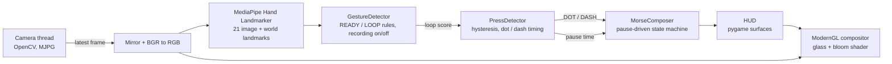

# Hand Morse

Type Morse code with two fingers in front of a webcam. Hold the index and middle fingers straight and together to switch recording on, then bend them so the fingertips meet in a loop: a short loop is a dot, a long loop is a dash, and straightening the fingers again ends the symbol. Everything is timed in one adjustable unit t, and the decoded text appears on screen as you type.

| Pose | What it does |
|---|---|
| READY: index and middle straight, side by side, tips touching, ring and pinky folded | Switches recording on (held for 0.15 s) |
| LOOP: the same two fingers bent so the tips meet above an open gap | The Morse key: short = dot, long = dash |
| Anything else, or no hand | Recording off. A loop made now types nothing |

---

## Quick start

### 1. Requirements

| | |
|---|---|
| Python | 3.10, 3.11 or 3.12 (MediaPipe does not always support the newest Python right away) |
| Webcam | Any USB, built-in or phone camera. 30 FPS or more is recommended |
| GPU | Anything that supports OpenGL 3.3 (every integrated GPU from the last ten years) |
| OS | Windows 10/11 (main target), macOS and Linux also work |

### 2. Install

**Windows (PowerShell)**

```powershell
cd AI_computer_vision_morse_coding
python -m venv .venv
.venv\Scripts\Activate.ps1
python -m pip install --upgrade pip
pip install -r requirements.txt
```

**macOS / Linux**

```bash
cd AI_computer_vision_morse_coding
python3 -m venv .venv
source .venv/bin/activate
python -m pip install --upgrade pip
pip install -r requirements.txt
```

The project uses pygame-ce, a maintained fork of pygame. If the classic `pygame` package is installed in the same environment, remove it first with `pip uninstall pygame`, because both packages provide the `pygame` module.

### 3. Run

```bash
python main.py
```

On the first launch the hand tracking model (`hand_landmarker.task`, about 7.5 MB) is downloaded into `models/` if it is not there yet. Later launches work offline.

### 4. Run the tests (optional)

```bash
python -m unittest discover -s tests -v
```

The tests cover the Morse logic, the hand gesture rules (including landmarks measured on two photos of the gestures), the press detector and the code kept from earlier versions. They do not need a camera.

---

## How to use it

### Typing

1. Raise your hand with the index and middle fingers straight and together, ring and pinky folded under the thumb. After 0.15 s the title says "Recording" and the hand panel turns green.
2. Bend the two fingers into a loop and straighten them again. How long the loop is held decides the symbol.
3. Keep the fingers straight to end a letter or a word.

All timings come from one time unit t (0.25 s by default, adjustable in the settings window):

| Fingers | Result | With t = 0.25 s |
|---|---|---|
| Loop shorter than 1.5 t | Dot `·` | under 0.375 s |
| Loop 1.5 t or longer | Dash `–` | 0.375 s or more |
| Straight (or hand away) for 3 t | End of letter | 0.75 s |
| Straight (or hand away) for 7 t | End of word, a space is added | 1.75 s |

A dash is typed the moment the loop reaches 1.5 t, while the fingers are still bent. A dot can only be known once they straighten.

A loop only counts after READY has switched recording on. If the hand leaves the picture or changes to another shape for more than 0.25 s, recording switches off, and a loop that was in progress is dropped without typing anything. A shorter gap (one or two lost frames) changes nothing.

Example, typing "SOS": three short loops, straight 1 s, three long loops, straight 1 s, three short loops.

### Touch point on the camera image

When the index and middle fingertips touch, a glowing point appears between them on the camera image. It is white while recording is off, green while recording, and cyan or violet during a loop (the colour of the symbol it would type), and it grows a little while a loop is held. Nothing else is drawn on the hand. The point is hidden while it sits behind a glass panel, and Z hides it with the rest of the interface.

### Hand panel (debug)

The top-left panel redraws the tracked hand skeleton: every bone thin and grey, the index and middle fingers bold. They are grey while recording is off, green while recording, and cyan or violet during a loop (the colour of the symbol it would type). Next to the skeleton:

- State: NO HAND, OFF, READY or LOOP, and whether recording is on. READY or LOOP in amber means the pose is seen but recording is not on yet (hold READY first).
- Curl: how far the two fingers bend, in degrees (bend of the index plus bend of the middle finger at their two middle joints). At or above the loop angle it counts as a loop.
- Tip gap: distance between the two fingertips, divided by the palm width. Below 0.60 the tips count as touching.

The Finger curl bar shows the same curl. The white tick is the loop angle, the faint tick 6° lower is where a loop is released. Press F for the full list of rules with their measured values, and G to show the timing legend in the top-left panel instead.

### Keyboard shortcuts

| Key | Action |
|---|---|
| `X` | Open or close the settings window |
| `Z` | Hide or show the interface. Hidden = normal camera colours and no typing |
| `P` | Pause or resume listening |
| `H` | Show or hide the Morse chart |
| `F` | Show every gesture rule with its measured value |
| `G` | Switch the top-left panel between the hand skeleton and the timing legend |
| `L` | Start or stop recording measurements to `logs/hand_*.csv` |
| `N` (hold) | While recording, marks the frames where you make the loop (the `label` column) |
| `M` | Mute or unmute sounds |
| `Backspace` | Delete the last symbol, or the last letter if no symbol is pending |
| `Delete` | Clear everything |
| `Esc` / `Q` | Quit |

### Settings window

Press X to open it. Changes apply instantly and are saved to `settings.json` when the app closes.

Camera tab: device, resolution, FPS, mirror, exposure, brightness, contrast, gain, and (on Windows) the camera driver's own dialog.

Hand tab:

- Loop angle: the curl at which the fingers count as a loop (85° by default). Raise it if a straight pose types dots, lower it if loops are missed. The hand panel shows your own curl live.
- Time unit t: the base timing, from 0.05 to 0.6 s. A card below spells out what every rule means in seconds.
- Ring + pinky must be folded: turn it off to accept the pose with an open hand.

### Tips for a good signal

- Show the whole hand, wrist included, side-on to the camera as in the reference photos. The palm detector finds a hand much more easily when the palm and wrist are visible.
- Light the hand from the front and keep it away from a background of the same colour.
- Choose 60 FPS if the camera supports it.

### Troubleshooting

| Problem | Fix |
|---|---|
| Recording never switches on | Press F and look for the rule marked "no". Usually the fingertips are too far apart or ring and pinky are not folded far enough |
| A straight pose types dots | Raise Loop angle a few degrees above the curl shown while straight |
| Loops are missed | Lower Loop angle a few degrees below the curl shown during the loop |
| Short loops come out as dashes | Raise Time unit t |
| Letters end before you are done | Raise Time unit t |
| "Camera unavailable" | Close other apps using the camera, or pick another device in settings |
| FPS below 15 | Choose 640×480, turn off auto exposure in a dark room, plug the laptop in |

---

## How it works

### Pipeline



### Measurements (`hand.py`)

All measurements use MediaPipe's world landmarks, which are in metres around the hand's own centre, so they do not change with the distance to the camera or with the hand's angle.

| Measurement | Definition |
|---|---|
| reach | Wrist-to-fingertip distance divided by the wrist-to-middle-knuckle distance (landmarks 0 and 9). A raised finger reaches far, a folded finger stays near the palm |
| bend | How far a finger bends at its two middle joints, in degrees (0 = straight) |
| curl | bend of the index + bend of the middle finger |
| tip gap | Distance between landmarks 8 and 12 divided by the palm width (landmarks 5 and 17) |

The pose counts when the index and middle reach is above 1.30, the ring and pinky reach below 1.25, and the tip gap below 0.60 (it has to rise above 0.75 before the tips count as apart again). Inside the pose, the curl decides READY or LOOP.

On the two reference photos, fed through the tracker like camera frames, the curl was 66 to 74° for READY and 95 to 99° for LOOP. The tip gap was 0.41 to 0.52 in both, the reach about 1.7 to 1.9 for the raised fingers and about 0.9 for the folded ones. The default loop angle of 85° sits between the two curls.

### Recording on and off

Recording switches on after the pose has been READY for 0.15 s, and stays on while the hand keeps the pose (READY or LOOP). When the pose is lost for more than 0.25 s, recording switches off and any loop in progress is dropped. During a shorter gap the press detector is left alone, so a lost frame neither releases a loop nor lets it grow into a dash without a hand.

### Press detector (`press.py`)

The curl becomes a score, `0.5 + (curl - loop angle) / 40`. A loop counts as pressed above 0.5 and released below 0.35, which is 6° under the loop angle. A press ends after two straight frames in a row. A dash is typed once the press is 1.5 t old, but only while the score is still above 0.5.

### Measurement log for analysis

Press L to record, hold N while you make the loop, press L again to stop. Each row of `logs/hand_*.csv` holds the time, your label, the state, whether recording and a press were active, the score, the curl, the tip gap, the middle-joint gap, and the reach and bend of all four fingers. This is enough to choose a better loop angle with a ROC curve, or to train a classifier later.

### Morse state machine (`morse.py`)

`MorseComposer` knows nothing about cameras. It is driven by symbols and by the idle time reported every frame:

| State | Input | Result |
|---|---|---|
| any | dot / dash | append to `code`, cancel a pending space |
| `code` not empty | idle ≥ `letter_gap` (3 t) | decode, `LETTER` (arms the space) or `INVALID` |
| space armed | idle ≥ `word_gap` (7 t) | `SPACE` (never leading, never doubled) |
| `code` already 6 symbols long | dot / dash | `INVALID` right away, since no code is longer |
| any | Backspace | remove last symbol, otherwise last character |

The table follows ITU-R M.1677-1 for A to Z, 0 to 9 and common punctuation.

### Threads, rendering and audio

- Camera thread (`camera.py`): publishes only the newest frame, with `CAP_PROP_BUFFERSIZE = 1` and MJPG. On Windows the backends are tried in the order DirectShow, Media Foundation, default.
- Main thread: hand detection, gesture rules, press detector, HUD drawing and the OpenGL composition, in that order, so the symbol and its sound are produced before any drawing.
- Settings window (`settings_window.py`): a separate `spawn` process, because a second window in the same process would fight over the OpenGL context. Messages are small tuples over a `multiprocessing.Pipe`.
- Compositor (`compositor.py`): one fragment shader draws the camera image, frosted glass panels (up to 10) and a bloom from the glow layer.
- Audio (`audio.py`): every sound is synthesised with NumPy at start-up, with a 256-sample mixer buffer.

The app never records or uploads camera images. Each frame is processed in memory and thrown away. The L key only writes numbers (measurements and states), never pictures.

---

## Project structure

```
AI_computer_vision_morse_coding/
├── main.py                  entry point
├── requirements.txt
├── blink_morse/
│   ├── app.py               main loop, wires everything together
│   ├── config.py            constants, colours, saved settings
│   ├── camera.py            threaded webcam reader
│   ├── hand_tracker.py      MediaPipe Hand Landmarker wrapper, hand skeleton bones
│   ├── hand.py              READY / LOOP rules, recording on/off, measurement log
│   ├── press.py             dot / dash timing from the loop score
│   ├── morse.py             Morse table and composer state machine
│   ├── hud.py               everything drawn on top of the camera
│   ├── draw.py              anti-aliased shapes, glow sprites, easing
│   ├── compositor.py        ModernGL shader: glass panels and bloom
│   ├── audio.py             synthesised feedback sounds
│   ├── settings_window.py   settings window (separate process)
│   └── (not used by the app, kept from earlier versions: blinks.py,
│        face_tracker.py, face_view.py, mesh_data.py, fusion.py, smile.py,
│        filters.py)
├── assets/fonts/            Inter and JetBrains Mono (OFL)
├── models/                  hand model, downloaded on first run
├── logs/                    measurement CSV files (L key), not in git
└── tests/                   unit tests, no camera needed
```

## Credits

- Hand tracking model: Google MediaPipe, Apache License 2.0.
- One Euro filter: Casiez, Roussel and Vogel (2012), "1€ Filter: A Simple Speed-based Low-pass Filter for Noisy Input in Interactive Systems", CHI 2012.
- Fonts: Inter by Rasmus Andersson and JetBrains Mono by JetBrains, both under the SIL Open Font License 1.1 (licence files in `assets/fonts`).
