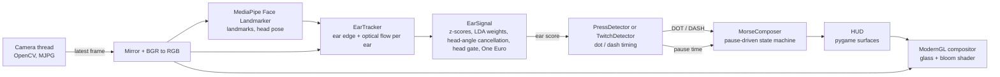

# Ear Morse

Type Morse code by moving your ears in front of a webcam. In hold mode, a short pull of the ears is a dot and a long pull is a dash. In twitch mode, for ears that can twitch but not stay pulled back, one wiggle is a dot and two quick wiggles are a dash. Relaxed ears end a letter or a word. Everything is timed in one adjustable unit t, and the decoded text appears on screen as you type.

MediaPipe tracks 478 points on the face, but none of them is on the ears, and none of its expression scores covers them. So the app measures each visible ear straight from the camera pixels: how far the outer edge of the ear reaches beyond the face, and how points on the ear move once the head's own motion is removed. A 14-second guided calibration learns how much each measurement is worth for your ears, and how much of it is only the head turning.

---

## Quick start

### 1. Requirements

| | |
|---|---|
| Python | 3.10, 3.11 or 3.12 (MediaPipe does not always support the newest Python right away) |
| Webcam | 720p or 1080p. 60 FPS is recommended, because a wiggle lasts only 0.2 to 0.4 s |
| GPU | Anything that supports OpenGL 3.3 (every integrated GPU from the last ten years) |
| OS | Windows 10/11 (main target), macOS and Linux also work |

### 2. Install

**Windows (PowerShell)**

```powershell
cd AI_computer_vision_morse_coding
python -m venv .venv
.venv\Scripts\Activate.ps1
python -m pip install --upgrade pip
pip install -r requirements.txt
```

**macOS / Linux**

```bash
cd AI_computer_vision_morse_coding
python3 -m venv .venv
source .venv/bin/activate
python -m pip install --upgrade pip
pip install -r requirements.txt
```

The project uses pygame-ce, a maintained fork of pygame. If the classic `pygame` package is installed in the same environment, remove it first with `pip uninstall pygame`, because both packages provide the `pygame` module.

### 3. Run

```bash
python main.py
```

On the first launch the face tracking model (`face_landmarker.task`, about 3.7 MB) is downloaded into `models/`. Later launches work offline.

### 4. Run the tests (optional)

```bash
python -m unittest discover -s tests -v
```

The tests cover the Morse logic, the ear measurements on synthetic images, the head-angle cancellation in the calibration, the press and twitch detectors, and the modules from the earlier smile, nose and blink versions. They do not need a camera.

---

## Setting up the camera

The ear signal is small. On the reference video (1280×720, outer eye corners 230 px apart), a wiggle moved the outer edge of the ear by 2 to 3 px. Turning the head by 1 degree moved the same edge by 2.6 px. A good picture of the ear makes most of the difference:

- Turn your head a little (5 to 10 degrees) so that one ear stands out clearly beside the face. The app uses every ear it can see, and one is enough.
- Keep hair off the ear and off the cheek in front of it. The skin colour is sampled on that cheek.
- Sit in front of a plain background that is not skin coloured, such as a white or grey wall. A wooden door or a beige wall behind the ear can be mistaken for skin.
- Light the face and the ear from the front.
- Use 1080p if the camera can deliver it at 30 FPS or more. At 1080p the same wiggle moves the edge by 3 to 4.5 px.

Glasses are fine. The gap left by a glasses arm crossing the ear is closed before the edge is measured.

---

## How to use it

### Calibration (about 14 seconds)

Calibration starts by itself when the app opens, and again whenever you press C. A prompt at the top of the screen tells you what to do:

1. "Relax your ears" for 2 s.
2. "Turn your head a little" for 3 s: keep the ears relaxed and turn the head slowly left and right by a few degrees.
3. "Pull your ears back, hold" (hold mode) or "Wiggle your ears" (twitch mode) for 1.5 s, then "Relax your ears" for 1.5 s. This is repeated three times.

Step 2 is there because a head turn moves the ear on camera as much as a wiggle does. The calibration learns how the ear measurements follow the head angle and subtracts that part, so small head movements while typing do not count as wiggles.

When calibration finishes, the lower Ears panel shows the result:

| Label | Meaning |
|---|---|
| good (d' 3 or more) | Relaxed and moving ears are clearly apart. Typing should be reliable |
| weak (d' 1.5 to 3) | It works, but expect some missed or extra symbols. Check the camera setup above, then press C |
| poor (d' under 1.5) | Hard to tell apart. Move closer, turn so one ear is clearly visible, press C |
| default weights | No ear movement was seen during calibration. Press C and try again |

d' is the distance between "relaxed" and "moving" measured in units of the resting noise. The console also prints a line that starts with `Calibration:` and lists each measurement's share of the ear score.

### Typing in hold mode

All timings come from one time unit t (0.25 s by default, adjustable in the settings window):

| Ears | Result | With t = 0.25 s |
|---|---|---|
| Short pull, shorter than 1.5 t | Dot `·` | under 0.375 s |
| Long pull, 1.5 t or longer | Dash `–` | 0.375 s or more |
| Relaxed for 3 t | End of letter | 0.75 s |
| Relaxed for 7 t | End of word, a space is added | 1.75 s |

A dash is typed the moment the pull reaches 1.5 t, while the ears are still pulled back. A dot can only be known once the ears relax.

### Typing in twitch mode

Most people can wiggle their ears but cannot hold them back for long. Press T (or use the toggle in the settings window) to switch to twitch mode:

| Ears | Result | With t = 0.25 s |
|---|---|---|
| One wiggle, then nothing for 2 t | Dot `·`, typed after the wait | 0.5 s after the wiggle |
| A second wiggle within 2 t | Dash `–`, typed at once | within 0.5 s |
| Relaxed for 3 t after the symbol | End of letter | 0.75 s |
| Relaxed for 7 t after the symbol | End of word, a space is added | 1.75 s |

How long a wiggle lasts does not matter in this mode. While the app waits to see whether a second wiggle follows, the hint at the bottom says so.

Example, typing "SOS" in twitch mode: three single wiggles with a short pause after each, relax 1 s, three double wiggles, relax 1 s, three single wiggles.

### The ear score

The readout next to the ear and the Ears bar show the ear score: 0 % is your relaxed ears, 100 % is your average movement from calibration. The white tick on the bar is the threshold (50 % by default), the faint tick is 100 %. The readout lights up cyan while the movement would be a dot and violet once it has become a dash.

The app ignores the ears while the head is more than 12 degrees (yaw) or 10 degrees (pitch) away from the pose saved at calibration. The status line under the title then says "Face the camera".

### Ears panel (debug)

The top-left panel shows a close-up of each ear, L and R as they appear on screen, rotated so the head is upright:

- The thin white line is the edge of the face where MediaPipe's tracking stops.
- The coloured line is the measured outer edge of the ear. It turns cyan or violet while a movement is being typed.
- "hidden" means the ear could not be measured in this frame: it is behind the head, covered by hair, or the cheek sample next to it is not skin.

Under the close-ups, yaw and pitch show how far the head is turned, and "Δ" shows the difference from the calibrated pose against the limits above. If the coloured line jumps around while your ears are still, the picture is too small or too dark for this method, and the camera setup above is the first thing to fix.

Press G to show the timing legend in this panel instead.

### Keyboard shortcuts

| Key | Action |
|---|---|
| `C` | Calibrate again |
| `T` | Switch between hold mode and twitch mode |
| `X` | Open or close the settings window |
| `Z` | Hide or show the interface. Hidden = normal camera colours and no typing |
| `P` | Pause or resume listening |
| `H` | Show or hide the Morse chart |
| `F` | Show the feature panel: each measurement's share of the ear score and its live z-score |
| `G` | Switch the top-left panel between the ear close-ups and the timing legend |
| `L` | Start or stop recording features to `logs/ear_*.csv` |
| `N` (hold) | While recording, marks the frames where your ears are moving (the `label` column) |
| `M` | Mute or unmute sounds |
| `Backspace` | Delete the last symbol, or the last letter if no symbol is pending |
| `Delete` | Clear everything |
| `Esc` / `Q` | Quit |

### Settings window

Press X to open it. Changes apply instantly and are saved to `settings.json` when the app closes.

Camera tab: device, resolution, FPS, mirror, exposure, brightness, contrast, gain, and (on Windows) the camera driver's own dialog.

Ears tab:

- Ear threshold: how large a movement must be to count, as a share of your average calibration movement. Lower it if movements are missed, raise it if symbols appear on their own.
- Time unit t: the base timing, from 0.05 to 0.6 s. A card below spells out what every rule means in seconds for the current mode.
- Twitch mode: the same switch as the T key.
- Calibrate again: same as the C key.

### Troubleshooting

| Problem | Fix |
|---|---|
| Both close-ups say "hidden" | Turn the head a little so one ear is clear of the face, move hair off the ear and cheek, use a plainer background |
| Calibration says "default weights" or "poor" | Check the camera setup, move closer, make the movement clearly during the prompts, press C |
| You cannot hold your ears back | Press T for twitch mode, then press C so the calibration asks for wiggles |
| Symbols appear when you turn or nod | Press C and turn the head a bit more during the "Turn your head a little" step. Raise Ear threshold if it continues |
| Two wiggles come out as two dots | Raise Time unit t, so the window for the second wiggle is longer |
| Single wiggles take too long to appear | Lower Time unit t |
| "ears re-centred" pops up | The score stayed above the threshold for 4 s, so the resting level was reset. If it happens often, recalibrate |
| "Camera unavailable" | Close other apps using the camera, or pick another device in settings |
| FPS below 15 | Choose a lower resolution, turn off auto exposure in a dark room, plug the laptop in |

---

## How it works

### Pipeline



### Ear measurements (`ear.py`)

Every distance is measured along the head's own axes (the line through the outer eye corners, landmarks 33 and 263, and the line from the nose bridge 168 towards the chin 152) and divided by the distance between the outer eye corners. Moving closer to the camera or tilting the head sideways does not change it. The face-edge landmarks 234 and 454 sit just in front of the ears and are the reference point for each side.

| Feature | What it measures |
|---|---|
| `edge_l`, `edge_r` | How far the outer edge of the ear reaches beyond the face edge, for the ear on the left and the right of the screen |
| `move_lx`, `move_ly`, `move_rx`, `move_ry` | How far points on the ear have moved outwards (x) and downwards (y) from where they rest, after the head's own motion is removed |
| `yaw`, `pitch` | Head angles. They are not part of the movement itself: the calibration uses them to cancel the part of the other features that only follows the head |

The edge is found in four steps:

1. The skin colour (Cr and Cb in YCrCb) is sampled on the cheek next to the ear. If the sample is not red enough to be skin, the cheek is covered by hair or glasses and the ear counts as hidden.
2. 15 rows across the upper part of the ear are sampled, one pixel at a time, from just inside the face edge to 0.55 eye distances outwards. A pixel counts as skin when its colour is close to the cheek sample.
3. Small gaps along a row are closed, and the ear is the largest connected skin region that starts within 0.2 eye distances of the face edge, spans at least 3 rows and is wide enough to be an ear. A darker band between the cheek and the ear (shadow, hair, the fold in front of the ear) does not stop the measurement.
4. The edge is the median over the rows of the region's outermost pixel. Rows that reach the end of the scan are ignored, because their edge is out of view.

The motion features use Lucas-Kanade optical flow on up to 40 corner points inside the ear region. The motion of the head between two frames is estimated from 14 landmarks that move with the skull only (eye corners, nose and forehead) as a similarity transform. The ear points' motion minus what that transform predicts is the ear's own motion. It is summed over frames with a leak of 1.5 s, so the value returns to 0 while the ear rests.

The ear measurements took about 4 ms per frame at 1280×720 on the CPU used for testing, on top of MediaPipe.

### Fusion: linear discriminant with head-angle cancellation (`fusion.py`)

The calibration frames are split into rest (the relax and head-turn steps) and movement. The first 0.45 s of every step is dropped for reaction time. Then:

1. Each feature is standardised with its resting mean and noise: `z = (x - mean_rest) / std_rest`.
2. On the rest frames, a ridge regression predicts each ear feature from yaw and pitch. That prediction is subtracted from the rest and movement frames, leaving residuals that do not follow the head.
3. `d` = mean residual during the movement steps. `C` = covariance of the residuals at rest, with the correlations shrunk 15 % towards zero.
4. Weights `w = C⁻¹ d` (Fisher's linear discriminant), divided by `d · C⁻¹ d` so the average calibration movement scores exactly 1. Yaw and pitch get the weights `-B · w`, where `B` holds the regression coefficients from step 2. In the live score this subtracts the part of each ear feature that the head angle predicts.
5. Quality `d' = sqrt(d · C⁻¹ d)`.

A feature that does not react for a given person gets a weight near zero, so nothing has to be tuned by hand. If an ear stays hidden during calibration, its features are left out, and a feature that is missing in a frame adds nothing to the score. The F panel shows each feature's share of an average movement, `w × d`, which adds up to 100 %. If calibration sees no movement (d' under 0.8), a fallback uses only the two edge features, with an edge moving inwards raising the score.

On the reference video, a calibration on the first half of the frames reached d' 4.3 to 4.6, and its score correlated 0.60 to 0.74 with a separate measure of the wiggles on the second half.

`fusion.py` knows nothing about ears: `EarSignal` only lists its features, their noise floors, the fallback weights, the nuisance features and the calibration steps. The smile version (`smile.py`) uses the same calibration.

### Running signal

Each frame the score is `Σ w·z`, smoothed with a One Euro filter (min cutoff 2.5 Hz, beta 0.5), which smooths hard when the score is steady and lets fast changes through. The score is forced to 0 when the head is more than 10 degrees (pitch) or 12 degrees (yaw) away from the calibrated pose.

While the score is under 0.2, the resting means follow slow changes with a 6 s time constant, and with 20 s while it is between 0.2 and 90 % of the threshold, so a small posture change cannot hold the score just under the threshold. A score above the threshold for 4 s is not real typing, so the resting means are re-centred on the current values.

### Press and twitch detectors (`press.py`)

`PressDetector` (hold mode): the ears count as pressed above the threshold and released below `max(threshold - 0.15, 0.6 × threshold)`. A press ends after two relaxed frames in a row, so one noisy frame cannot split it. A dash is typed once the press is 1.5 t old, but only while the score is still above the threshold itself, so the fading tail of the filtered score cannot stretch a dot into a dash.

`TwitchDetector` (twitch mode) finds each wiggle with the same hysteresis and only counts releases. A second release within 2 t of the first is a dash. A single release with no second one after 2 t is a dot. The letter and word pauses count from the moment the symbol is typed.

### Feature log for analysis

Press L to record, hold N while you move your ears, press L again to stop. Each row of `logs/ear_*.csv` holds the time, your label, the score, the raw score, whether a press was active, the gate, the calibration step, pitch, yaw, the eight features and their z-scores. This is enough to compare features with ROC AUC or effect size in a notebook, or to train a classifier later.

### Morse state machine (`morse.py`)

`MorseComposer` knows nothing about cameras. It is driven by symbols and by the idle time reported every frame:

| State | Input | Result |
|---|---|---|
| any | dot / dash | append to `code`, cancel a pending space |
| `code` not empty | idle ≥ `letter_gap` (3 t) | decode, `LETTER` (arms the space) or `INVALID` |
| space armed | idle ≥ `word_gap` (7 t) | `SPACE` (never leading, never doubled) |
| `code` already 6 symbols long | dot / dash | `INVALID` right away, since no code is longer |
| any | Backspace | remove last symbol, otherwise last character |

The table follows ITU-R M.1677-1 for A to Z, 0 to 9 and common punctuation.

### Threads, rendering and audio

- Camera thread (`camera.py`): publishes only the newest frame, with `CAP_PROP_BUFFERSIZE = 1` and MJPG. On Windows the backends are tried in the order DirectShow, Media Foundation, default.
- Main thread: detection, ear measurements, ear signal, press detector, HUD drawing and the OpenGL composition, in that order, so the symbol and its sound are produced before any drawing.
- Settings window (`settings_window.py`): a separate `spawn` process, because a second window in the same process would fight over the OpenGL context. Messages are small tuples over a `multiprocessing.Pipe`.
- Compositor (`compositor.py`): one fragment shader draws the camera image, frosted glass panels (up to 10) and a bloom from the glow layer.
- Audio (`audio.py`): every sound is synthesised with NumPy at start-up, with a 256-sample mixer buffer.

The app never records or uploads camera images. Each frame is processed in memory and thrown away. The ear close-ups in the HUD are cut from the current frame and are not kept either. The L key only writes numbers (features and scores), never pictures.

---

## Project structure

```
AI_computer_vision_morse_coding/
├── main.py                  entry point
├── requirements.txt
├── blink_morse/
│   ├── app.py               main loop, wires everything together
│   ├── config.py            constants, colours, saved settings
│   ├── camera.py            threaded webcam reader
│   ├── face_tracker.py      MediaPipe wrapper: landmarks, blendshapes, head pose
│   ├── ear.py               ear edge and optical flow measurements, EarSignal
│   ├── fusion.py            guided calibration (LDA), fused score, CSV log
│   ├── press.py             dot / dash timing: hold mode and twitch mode
│   ├── filters.py           One Euro filter
│   ├── morse.py             Morse table and composer state machine
│   ├── hud.py               everything drawn on top of the camera
│   ├── draw.py              anti-aliased shapes, glow sprites, easing
│   ├── compositor.py        ModernGL shader: glass panels and bloom
│   ├── audio.py             synthesised feedback sounds
│   ├── settings_window.py   settings window (separate process)
│   ├── smile.py             smile version (not used by the app)
│   ├── nose.py              nose version (not used by the app)
│   ├── blinks.py            blink version (not used by the app)
│   ├── face_view.py         face mesh view from the smile version (not used by the app)
│   └── mesh_data.py         face mesh edges for face_view.py
├── assets/fonts/            Inter and JetBrains Mono (OFL)
├── models/                  face model, downloaded on first run
├── logs/                    feature CSV files (L key), not in git
└── tests/                   unit tests, no camera needed
```

## Credits

- Face tracking model: Google MediaPipe, Apache License 2.0.
- One Euro filter: Casiez, Roussel and Vogel (2012), "1€ Filter: A Simple Speed-based Low-pass Filter for Noisy Input in Interactive Systems", CHI 2012.
- Optical flow: Lucas and Kanade (1981), as implemented in OpenCV (`calcOpticalFlowPyrLK`).
- Fonts: Inter by Rasmus Andersson and JetBrains Mono by JetBrains, both under the SIL Open Font License 1.1 (licence files in `assets/fonts`).
