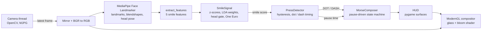

# Smile Morse

Type Morse code by smiling in front of a webcam. A short smile is a dot, a long smile is a dash, and a relaxed face ends a letter or a word. A smile counts with the lips closed or open. Everything is timed in one adjustable unit t, and the decoded text appears on screen as you type.

The app measures five features of the smile (MediaPipe's smile, cheek and dimple scores, the mouth width and how high the mouth corners sit) and learns, in a 10-second guided calibration, how much each one is worth for your face, your camera and your light.

---

## Quick start

### 1. Requirements

| | |
|---|---|
| Python | 3.10, 3.11 or 3.12 (MediaPipe does not always support the newest Python right away) |
| Webcam | Any USB, built-in or phone camera. 30 FPS or more is recommended |
| GPU | Anything that supports OpenGL 3.3 (every integrated GPU from the last ten years) |
| OS | Windows 10/11 (main target), macOS and Linux also work |

### 2. Install

**Windows (PowerShell)**

```powershell
cd AI_computer_vision_morse_coding
python -m venv .venv
.venv\Scripts\Activate.ps1
python -m pip install --upgrade pip
pip install -r requirements.txt
```

**macOS / Linux**

```bash
cd AI_computer_vision_morse_coding
python3 -m venv .venv
source .venv/bin/activate
python -m pip install --upgrade pip
pip install -r requirements.txt
```

The project uses pygame-ce, a maintained fork of pygame. If the classic `pygame` package is installed in the same environment, remove it first with `pip uninstall pygame`, because both packages provide the `pygame` module.

### 3. Run

```bash
python main.py
```

On the first launch the face tracking model (`face_landmarker.task`, about 3.7 MB) is downloaded into `models/`. Later launches work offline.

### 4. Run the tests (optional)

```bash
python -m unittest discover -s tests -v
```

The tests cover the Morse logic, the smile features, the feature fusion, the press detector, the face mesh view and the old blink detector. They do not need a camera.

---

## How to use it

### Calibration (about 10 seconds)

Calibration starts by itself when the app opens, and again whenever you press C. A prompt at the top of the screen tells you what to do:

1. "Relax your face" for 2 s.
2. "Smile, lips closed" for 1.5 s, then "Relax your face" for 1.5 s. This is repeated three times.

Keep your head still. Smile with your lips closed during the prompts: a closed-lip smile is the smallest kind, so once it scores 100 %, an open smile scores more and is detected too. When calibration finishes, the Smile panel shows the result:

| Label | Meaning |
|---|---|
| good (d' 3 or more) | Rest and smile are clearly apart. Typing should be reliable |
| weak (d' 1.5 to 3) | It works, but expect some missed or extra symbols. Try more light or a clearer smile, then press C |
| poor (d' under 1.5) | Hard to tell apart. Move closer to the camera, improve the light, press C |
| default weights | No smile was seen during calibration. Press C and try again |

d' is the distance between "relaxed" and "smiling" measured in units of the resting noise.

### Typing

All timings come from one time unit t (0.25 s by default, adjustable in the settings window):

| Face | Result | With t = 0.25 s |
|---|---|---|
| Short smile, shorter than 1.5 t | Dot `·` | under 0.375 s |
| Long smile, 1.5 t or longer | Dash `–` | 0.375 s or more |
| Relaxed for 3 t | End of letter | 0.75 s |
| Relaxed for 7 t | End of word, a space is added | 1.75 s |

A dash is typed the moment the smile reaches 1.5 t, while you are still smiling. A dot can only be known once the face relaxes.

The readout next to your mouth and the Smile bar show the smile score: 0 % is your relaxed face, 100 % is your average smile from calibration. The white tick on the bar is the threshold (50 % by default), the faint tick is 100 %. The readout lights up cyan while the smile would be a dot and violet once it has become a dash.

Turning the head changes the shape of the mouth on camera, so the app ignores the smile while the head is turned away from the calibrated pose. The status line under the title then says "Face the camera".

Example, typing "SOS": three short smiles, relax 1 s, three long smiles, relax 1 s, three short smiles.

### Face mesh panel (debug)

The top-left panel redraws the tracked face from its 478 landmarks: the face outline in bold, the inner mesh at 20 % opacity, and the lips in bold. The lip fill gets stronger as the smile score rises, and the lips glow in the dot or dash colour while a smile is being typed. If the mesh shakes while your face is still, the landmarks are noisy and the smile score will be too.

Next to the mesh:

- Yaw: how far the head is turned left or right, as seen on screen.
- Pitch: how far the head is tilted up or down.
- "Δ calib": the difference from the pose saved at calibration. It turns amber when it passes the limit shown at the top right (±20° for yaw, ±12° for pitch); past that limit the smile is ignored.

Press G to show the timing legend in this panel instead.

### Keyboard shortcuts

| Key | Action |
|---|---|
| `C` | Calibrate again |
| `X` | Open or close the settings window |
| `Z` | Hide or show the interface. Hidden = normal camera colours and no typing |
| `P` | Pause or resume listening |
| `H` | Show or hide the Morse chart |
| `F` | Show the feature panel: each feature's share of the smile score and its live z-score |
| `G` | Switch the top-left panel between the face mesh and the timing legend |
| `L` | Start or stop recording features to `logs/smile_*.csv` |
| `N` (hold) | While recording, marks the frames where you are smiling (the `label` column) |
| `M` | Mute or unmute sounds |
| `Backspace` | Delete the last symbol, or the last letter if no symbol is pending |
| `Delete` | Clear everything |
| `Esc` / `Q` | Quit |

### Settings window

Press X to open it. Changes apply instantly and are saved to `settings.json` when the app closes.

Camera tab: device, resolution, FPS, mirror, exposure, brightness, contrast, gain, and (on Windows) the camera driver's own dialog.

Smile tab:

- Smile threshold: how big a smile must be to count, as a share of your average calibration smile. Lower it if small smiles are missed, raise it if symbols appear on their own.
- Time unit t: the base timing, from 0.05 to 0.6 s. A card below spells out what every rule means in seconds.
- Calibrate again: same as the C key.

### Tips for a good signal

- Face the camera with the mouth fully visible. A phone through Camo, iVCam or EpocCam is much sharper than most laptop webcams.
- Light the face from the front. Shadows from the side move with every small head turn.
- Keep a neutral mouth between symbols. A face that is always half smiling leaves less room between "relaxed" and "smiling".
- Choose 60 FPS if the camera supports it.

### Troubleshooting

| Problem | Fix |
|---|---|
| Calibration says "default weights" or "poor" | More light, move closer, smile clearly during the prompts, press C |
| Small smiles are missed | Lower Smile threshold, or calibrate again with a smaller smile |
| Short smiles come out as dashes | Raise Time unit t |
| Symbols appear on their own (for example when talking) | Raise Smile threshold, press C to recalibrate |
| "face re-centred" pops up | The score stayed high for 8 s, so the resting level was reset. If it happens often, recalibrate |
| Letters end before you are done | Raise Time unit t |
| "Camera unavailable" | Close other apps using the camera, or pick another device in settings |
| FPS below 15 | Choose 640×480, turn off auto exposure in a dark room, plug the laptop in |

---

## How it works

### Pipeline



### Features (`smile.py`)

| Feature | What it measures |
|---|---|
| `smile` | Mean of the `mouthSmileLeft` and `mouthSmileRight` blendshapes |
| `cheek` | Mean of `cheekSquintLeft` and `cheekSquintRight` (cheeks pushed up) |
| `dimple` | Mean of `mouthDimpleLeft` and `mouthDimpleRight` |
| `width` | Distance between the mouth corners (landmarks 61 and 291) |
| `lift` | How far the mouth corners sit above the top of the upper lip (landmark 0), along the face's own up-down axis (landmark 168 to 152), so tilting the head sideways does not change it |

Both distances are divided by the distance between the inner eye corners (133 and 362), so moving closer to the camera does not change them. Every smile, open or closed, pulls the mouth corners up and outwards. Opening the mouth mainly moves the lower lip and the jaw, which these features do not measure directly, so the smile counts either way.

### Fusion: linear discriminant from the calibration (`fusion.py`)

From the calibration frames (the first 0.45 s of every step is dropped for reaction time):

1. Each feature is standardised with its resting mean and noise: `z = (x - mean_rest) / std_rest`.
2. `d` = mean z while smiling, per feature.
3. `C` = covariance of z at rest, shrunk 30 % towards the identity because features from the same face are correlated.
4. Weights `w = C⁻¹ d` (Fisher's linear discriminant), divided by `d · C⁻¹ d` so the average calibration smile scores exactly 1.
5. Quality `d' = sqrt(d · C⁻¹ d)`.

A feature that does not react for a given person gets a weight near zero, so nothing has to be tuned by hand. The F panel shows each feature's share of an average smile, `w × d`, which adds up to 100 %. If calibration sees no smile (d' under 0.8), a fallback uses the mean z of `smile`, `width` and `lift`, with a smile assumed at 3 standard deviations.

`fusion.py` knows nothing about smiles: `SmileSignal` only lists its features, their noise floors, the fallback weights and the word on the prompt. Another body part can reuse the same calibration by defining its own subclass.

### Running signal

Each frame the score is `Σ w·z`, smoothed with a One Euro filter (min cutoff 2.5 Hz, beta 0.5), which smooths hard when the score is steady and lets fast changes through. The score is forced to 0 when the head is more than 12° (pitch) or 20° (yaw) away from the calibrated pose.

While the score is under 0.2, the resting means follow slow changes with a 6 s time constant, and with 20 s while it is between 0.2 and 90 % of the threshold, so a small posture change cannot hold the score just under the threshold. A score above the threshold for 8 s is not real typing, so the resting means are re-centred on the current values.

### Press detector (`press.py`)

A smile counts as pressed above the threshold and released below `max(threshold - 0.15, 0.6 × threshold)`. A press ends after two relaxed frames in a row, so one noisy frame cannot split it. A dash is typed once the press is 1.5 t old, but only while the score is still above the threshold itself. MediaPipe and the filter make the score fade out over about 0.2 s after a smile, and that tail must not stretch a dot into a dash.

### Feature log for analysis

Press L to record, hold N while you smile, press L again to stop. Each row of `logs/smile_*.csv` holds the time, your label, the score, the raw score, whether a press was active, the gate, the calibration step, pitch, yaw, the five features and their z-scores. This is enough to compare features with ROC AUC or effect size in a notebook, or to train a classifier later.

### Morse state machine (`morse.py`)

`MorseComposer` knows nothing about cameras. It is driven by symbols and by the idle time reported every frame:

| State | Input | Result |
|---|---|---|
| any | dot / dash | append to `code`, cancel a pending space |
| `code` not empty | idle ≥ `letter_gap` (3 t) | decode, `LETTER` (arms the space) or `INVALID` |
| space armed | idle ≥ `word_gap` (7 t) | `SPACE` (never leading, never doubled) |
| `code` already 6 symbols long | dot / dash | `INVALID` right away, since no code is longer |
| any | Backspace | remove last symbol, otherwise last character |

The table follows ITU-R M.1677-1 for A to Z, 0 to 9 and common punctuation.

### Threads, rendering and audio

- Camera thread (`camera.py`): publishes only the newest frame, with `CAP_PROP_BUFFERSIZE = 1` and MJPG. On Windows the backends are tried in the order DirectShow, Media Foundation, default.
- Main thread: detection, smile signal, press detector, HUD drawing and the OpenGL composition, in that order, so the symbol and its sound are produced before any drawing.
- Settings window (`settings_window.py`): a separate `spawn` process, because a second window in the same process would fight over the OpenGL context. Messages are small tuples over a `multiprocessing.Pipe`.
- Compositor (`compositor.py`): one fragment shader draws the camera image, frosted glass panels (up to 10) and a bloom from the glow layer.
- Audio (`audio.py`): every sound is synthesised with NumPy at start-up, with a 256-sample mixer buffer.

The app never records or uploads camera images. Each frame is processed in memory and thrown away. The L key only writes numbers (features and scores), never pictures.

---

## Project structure

```
AI_computer_vision_morse_coding/
├── main.py                  entry point
├── requirements.txt
├── blink_morse/
│   ├── app.py               main loop, wires everything together
│   ├── config.py            constants, colours, saved settings
│   ├── camera.py            threaded webcam reader
│   ├── face_tracker.py      MediaPipe wrapper: landmarks, blendshapes, head pose
│   ├── smile.py             smile features and SmileSignal
│   ├── fusion.py            guided calibration (LDA), fused score, CSV log
│   ├── press.py             dot / dash timing from the score
│   ├── blinks.py            blink detector from the eye version (not used by the app)
│   ├── filters.py           One Euro filter
│   ├── morse.py             Morse table and composer state machine
│   ├── hud.py               everything drawn on top of the camera
│   ├── face_view.py         face mesh debug view (outline, mesh, lips)
│   ├── mesh_data.py         face mesh edges, lip and nostril landmarks
│   ├── draw.py              anti-aliased shapes, glow sprites, easing
│   ├── compositor.py        ModernGL shader: glass panels and bloom
│   ├── audio.py             synthesised feedback sounds
│   └── settings_window.py   settings window (separate process)
├── assets/fonts/            Inter and JetBrains Mono (OFL)
├── models/                  face model, downloaded on first run
├── logs/                    feature CSV files (L key), not in git
└── tests/                   unit tests, no camera needed
```

## Credits

- Face tracking model: Google MediaPipe, Apache License 2.0.
- One Euro filter: Casiez, Roussel and Vogel (2012), "1€ Filter: A Simple Speed-based Low-pass Filter for Noisy Input in Interactive Systems", CHI 2012.
- Fonts: Inter by Rasmus Andersson and JetBrains Mono by JetBrains, both under the SIL Open Font License 1.1 (licence files in `assets/fonts`).
