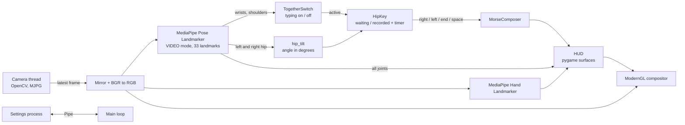

# Hip Morse

Type Morse code by swaying your hips in front of a webcam. Put **both hands together** to switch typing on or off. Then tilt your hips past an angle **A**: **right hip up** is a dash, **left hip up** is a dot. While the hips are inside the waiting zone (between -A and A), waiting longer than **t** ends the letter and waiting longer than **3t** adds a space. The app reads your body with MediaPipe Pose and draws the torso, legs, arms and both hand skeletons (MediaPipe Hands) on the camera image.

---

## Quick start

### 1. Requirements

| | |
|---|---|
| Python | 3.10, 3.11 or 3.12 (MediaPipe does not always support the newest Python right away) |
| Webcam | Any USB, built-in or phone camera. 30 FPS or more is recommended |
| GPU | Anything that supports OpenGL 3.3 (every integrated GPU from the last ten years) |
| OS | Windows 10/11 (main target), macOS and Linux also work |

### 2. Install

**Windows (PowerShell)**

```powershell
cd AI_computer_vision_morse_coding
python -m venv .venv
.venv\Scripts\Activate.ps1
python -m pip install --upgrade pip
pip install -r requirements.txt
```

**macOS / Linux**

```bash
cd AI_computer_vision_morse_coding
python3 -m venv .venv
source .venv/bin/activate
python -m pip install --upgrade pip
pip install -r requirements.txt
```

> The project uses **pygame-ce**, a maintained fork of pygame. If the classic `pygame` package is already installed in the same environment, remove it first with `pip uninstall pygame`, because both packages provide the `pygame` module.

### 3. Run

```bash
python main.py
```

On the first launch the pose model (`pose_landmarker_lite.task`, about 5.5 MB) is downloaded into `models/` (the hand model `hand_landmarker.task` is already there, or is downloaded too). Later launches work offline.

### 4. Run the tests (optional)

```bash
python -m unittest discover -s tests -v
```

The tests cover the Morse logic, the hip gesture logic, the hands-together switch and the left/right body mapping. They do not need a camera.

---

---

## How to use it

Stand far enough from the camera that your **shoulders, hips and wrists** are in view. Knees and feet are drawn when the camera sees them, but only the hips are needed for typing.

**Switch typing on / off: both hands together.** Bring your hands together (palms touching, wrists closer than 0.35 x your shoulder width) for about 0.15 s. The hand skeletons flash amber and the bottom strip shows `on` or `off`. Move the hands apart before the next switch. Nothing is typed while the hands are together.

**Hip angle.** The angle is the tilt of the line through your two hips on the image. 0° means level ("straight"). A positive angle means your right hip is higher than your left, a negative angle means your left hip is higher. Right and left are your own, whatever the camera shows.

| Hips | Result |
|---|---|
| Angle ≥ A (5° by default), right hip higher | Dash `-` |
| Angle ≤ -A, left hip higher | Dot `.` |
| Waiting (-A < angle < A) for more than **t** (0.6 s by default) | End of letter: the code becomes a letter |
| Waiting for more than **3t** (1.8 s) | Space (the letter is ended first if one is open) |

**Two states.** *Waiting* is -A < angle < A. *Recorded* means a sway was just typed. From waiting, the first frame with the angle past A types the symbol, with no hold time and no smoothing, and the key goes to recorded. It stays there until the hips come back into waiting (1° below A, so noise at the edge cannot type twice). Two dashes in a row therefore means right hip up, back, right hip up. Going straight from one side to the other types both. The waiting timer starts when the hips enter waiting, and the end of letter and the space each fire once per waiting period. A sway at any time types its symbol, so after a letter has ended the next sway starts the next letter. If your hips are already past A when typing is switched on, nothing is typed until they have come back to waiting and swayed again.

**Feedback.** The hip line turns amber while a sway is held after it fired, and flashes thicker when a symbol, letter end or space is typed. Press **H** to show the debug readout next to the hips: the angle, the state (`waiting`, or `dash ok` / `dot ok` once a sway has been typed), and a bar for the waiting timer with ticks at t (`end`) and 3t (`space`). Two thin lines through the hips show the angle A on each side, labelled with what they type. The bottom strip shows the code typed so far, the letter it decodes to (or the letters still reachable), the message, and the switch state. The Morse chart in the top-right corner dims letters the current code can no longer reach.

**Example: typing "HI"**

1. Put both hands together. The strip shows `on`.
2. Tilt the left hip up and back to level, four times (`....`).
3. Wait 0.6 s. **H** is added.
4. Tilt the left hip up and back twice (`..`), then wait 0.6 s. **I** is added.
5. Wait a further 1.2 s (1.8 s in total). A space is added.
6. Hands together again to switch typing off.

**Swap dot and dash.** If the direction feels the wrong way round for you, press **S** (or *Angle > A types* in the Hips settings tab). The choice is saved.

Press **P** to pause typing while you rest, or **Z** to hide the interface and stop input completely. Deleting is done on the keyboard.

### Keyboard shortcuts

| Key | Action |
|---|---|
| `S` | Swap dot and dash between the two sways |
| `X` | Open or close the settings window |
| `Z` | Hide or show the interface. Hidden = normal camera colours and no typing |
| `P` | Pause or resume typing |
| `H` | Show or hide the hip angle, the ±A lines and the waiting timer |
| `C` | Show or hide the Morse chart |
| `M` | Mute or unmute sounds |
| `Backspace` | Delete the last symbol, or the last letter if no symbol is pending |
| `Delete` | Clear everything |
| `Esc` / `Q` | Quit |

### Settings window

Press `X` to open it. It has two tabs. Changes apply instantly and are saved to `settings.json` when the app closes.

**Camera tab**
- Live stats: the real capture resolution, camera FPS and app FPS. Green is 30 FPS or more, amber is 15 to 30, red is below 15.
- Device number, with the device name underneath on Windows (for example "Integrated Webcam" or "Camo"), resolution, target FPS (30 or 60), mirror view, auto exposure, and manual exposure, brightness, contrast and gain.
- **Driver settings** (Windows) opens the camera maker's own settings dialog.

**Hips tab**
- **Angle A**: the hip tilt that types a symbol, and the edge of the waiting zone (default 5°).
- **Unit time t**: the waiting time that ends a letter. Three times this adds a space (default 0.6 s).
- **Hands together**: how close the wrists must be, as a fraction of shoulder width (default 0.35).
- **Angle > A types (S)**: whether angle ≥ A (right hip up) types a dash or a dot. Angle ≤ -A types the other one.
- **Swap left / right**: for cameras or phone apps that already mirror the image.

A card under the controls lists every gesture with the current numbers.

### Using an iPhone or Android phone as the camera

A phone camera is usually much sharper than a laptop webcam, and a sharper picture helps the pose model find the hips. Install a "phone as webcam" app such as Camo, iVCam or EpocCam on both the phone and the PC, connect the phone by USB, and the phone shows up as an extra camera. In the settings window, step **Device** to the new camera (its name is shown on Windows). Put the phone so that your body from the shoulders down to the knees is in view.

### Troubleshooting

**Black screen or 0 camera FPS.** The app tries several capture modes in turn (DirectShow with MJPG, DirectShow with the driver's own format, 30 fps, the driver's default size, then Media Foundation). A mode that hangs for 3 s or sends only black frames for 2.5 s is skipped, and the one that works is remembered in `settings.json` (`mode_hint`). The mode in use is shown under the title of the settings window. Virtual cameras such as Camo send black frames or nothing at all while the phone is not connected in the Camo app.

**Exposure / brightness / contrast / gain show "n/a".** The camera driver does not offer that control (virtual cameras like Camo have none of them). Change the picture in the camera's own app instead.

| Problem | Fix |
|---|---|
| "Camera unavailable" | Close other apps using the camera (Teams, Zoom, OBS), or pick another device in the settings window. |
| FPS below 15 | Choose 640×480 in settings, turn off auto exposure in a dark room (long exposure halves the frame rate), and plug the laptop in. |
| No bones, or the hip line jumps around | Step back until the hips and thighs are fully in view, wear clothes that contrast with the wall, and light the room evenly. |
| The angle stays near 0° when you sway | Press **H** and watch the number. Tilt more, or lower **Angle A** in the Hips tab. |
| Symbols appear when you did not sway | Raise **Angle A**, or press **P** while resting. |
| Right and left are swapped | Turn on **Swap left / right**, or press **S** to swap dot and dash. |
| Letters end before you are done | Raise **Unit time t**. |
| Typing feels slow | Lower **Unit time t**. |
| Nothing types | Put both hands together until the strip shows `on`. |
| Model download fails | Download the file from the URL in `blink_morse/config.py` and save it as `models/pose_landmarker_lite.task` (and `models/hand_landmarker.task`). |

---

## Tech stack

| Part | Library | Why |
|---|---|---|
| Body tracking | [MediaPipe Pose Landmarker](https://ai.google.dev/edge/mediapipe/solutions/vision/pose_landmarker) | 33 body points (shoulders, wrists, hips, knees, feet) in real time on a normal CPU |
| Hand tracking | [MediaPipe Hand Landmarker](https://ai.google.dev/edge/mediapipe/solutions/vision/hand_landmarker) | 21 points per hand, drawn on the image |
| Camera | [OpenCV](https://opencv.org/) | Reads the webcam and controls exposure, brightness and so on |
| Window and input | [pygame-ce](https://pyga.me/) | Window, keyboard, text rendering and sound playback |
| Rendering | [ModernGL](https://github.com/moderngl/moderngl) (OpenGL 3.3) | Puts the interface layer on top of the camera image on the graphics card |
| Maths | [NumPy](https://numpy.org/) | Landmark maths and sound synthesis |
| Camera names | [pygrabber](https://github.com/andreaschiavinato/python_grabber) (Windows, optional) | Lists DirectShow device names for the settings window |
| Fonts | Inter and JetBrains Mono | Bundled in `assets/fonts` under the SIL Open Font License |

No sound files and no image assets are shipped: every sound is synthesised at start-up and every shape is drawn in code.

---

## How it works (non-technical overview)

Think of the app as a small assembly line with five stations.

1. **The camera takes pictures.** About 30 to 60 times a second, the webcam sends a new picture of you.

2. **The body and hand readers find your joints.** Two pre-trained models from Google find your shoulders, wrists, hips, knees and feet, and the 21 points of each hand. Each hand is matched to the nearest wrist, so the app always knows which hand is the right one.

3. **The switch decides if you are typing.** Putting both hands together (wrists close compared with shoulder width) flips typing on or off.

4. **The hip reader turns your sway into keys.** It measures the tilt of the line through your hips. The moment the tilt passes the angle A, that is a dash (right hip up) or a dot (left hip up). While the tilt stays inside the waiting zone, a timer runs: at t the letter ends, at 3t a space is added. When a letter ends, the dots and dashes are looked up in the international Morse table; a code that does not exist is shown as "no match" instead of a guess.

5. **The screen shows the result.** The camera keeps its normal colours. Thin bones and hand skeletons show what the app sees, the Morse chart sits in the corner, and the code and message are in a small strip at the bottom. A short sound confirms every symbol, so you can type without looking.

The app never records or uploads anything. Every picture is processed in memory and thrown away straight after.

## How it works (technical deep dive)

### Pipeline



### Threads and processes

- **Camera thread** (`camera.py`) blocks on `VideoCapture.read()` and publishes only the newest frame through a `threading.Condition`. The main loop wakes up as soon as a frame arrives and never processes the same frame twice. `CAP_PROP_BUFFERSIZE = 1` and MJPG are requested so frames are fresh and 720p can still reach 30 to 60 FPS. On Windows the backends are tried in the order DirectShow, Media Foundation, default, which also covers virtual cameras created by phone-webcam apps.
- **Main thread** runs detection, the gesture logic, HUD drawing and the OpenGL composition, in that order. The symbol and its sound are produced before any texture upload or drawing, so rendering never adds to the reaction time.
- **Settings process** (`settings_window.py`). The main window owns an OpenGL context, and a second SDL window in the same process can steal or invalidate it. Running the settings UI in a `spawn` child process avoids that and keeps slider dragging from stalling the render loop. Messages are small tuples over a `multiprocessing.Pipe`.

### Body landmarks and side mapping (`body_tracker.py`)

MediaPipe names its landmarks after the body **as depicted in the image**. Mirroring the frame therefore swaps them: in the default selfie view, MediaPipe's "left" hip is the user's right hip. `build_body()` applies that swap once, so every other module only sees the user's own left and right (`left_hip`, `right_knee`, ...). A unit test pins this down. Joints with a visibility below 0.5 are dropped, so a leg that is out of frame is simply not drawn.

### Hip angle and hip key (`hip_gestures.py`)

`hip_tilt()` takes the two hip points in **pixels** (so the image aspect ratio does not bend the angle) and returns `atan2(dy, |dx|)` in degrees, with y flipped so that "the user's right hip is higher" is positive. Because only the horizontal distance is used and not its sign, the value is the same for a mirrored and a non-mirrored image. If the hips are less than 2 % of the image width apart (body turned sideways) there is no angle.

`HipKey` works on the raw angle (smoothing is available but off, because it costs reaction time) and has two states:

- **Waiting**, `|angle| < A`. A timer starts on entry. At `t` it emits `end`, at `3t` `space`, each once per waiting period. In this state `angle >= A` emits `right` and `angle <= -A` emits `left` on the first frame, and the key becomes recorded.
- **Recorded**. Nothing is emitted until `|angle| < A - margin` (margin 1°), which returns to waiting. A swing to the other side past A while recorded emits that side at once.

The app turns `right` into a dash and `left` into a dot (swappable with S).

While typing is off, `update(..., active=False)` still tracks the angle for the HUD but clears the latch and the timer, so a pose that is held when typing starts types nothing.

### Morse state machine (`morse.py`)

`MorseComposer` knows nothing about cameras, so it can be tested with plain function calls. The hip input uses three of its calls:

| Call | Result |
|---|---|
| `add_symbol(".")` / `add_symbol("-")` | append to `code`; a 7th symbol is `INVALID` right away, since no code is longer |
| `end_letter()` | decode `code`, `LETTER` or `INVALID`; nothing if `code` is empty |
| `add_space()` | end the open letter, then add one space (never leading, never doubled) |

The table follows ITU-R M.1677-1 for A to Z, 0 to 9 and common punctuation. Backspace removes the last symbol, or the last character when no symbol is pending.

### Rendering (`compositor.py` and `hud.py`)

The camera and the UI layer are uploaded as two textures and one small shader puts the UI on top. The camera keeps its own colours: no grading, dimming, blur or vignette. A cover crop (like CSS `object-fit: cover`) fills the 800×600 window at any camera aspect ratio without stretching.

The HUD is drawn with pygame on a transparent surface. Bones and hand skeletons are thin off-white lines with a 1 px dark outline so they stay visible on light and dark backgrounds; all outlines are drawn before the colours so joints stay clean. Text sits on a flat dark backdrop. Amber is the only accent colour.

### Audio (`audio.py`)

Tones are built with NumPy: a sine wave plus a soft second harmonic and a short attack and release to avoid clicks. The dash lasts three times as long as the dot, as in real Morse timing. The mixer is opened with a 256-sample buffer (about 6 ms) so the sound follows the movement closely.

### Performance budget

On the CPU side (camera upload, HUD drawing, layer upload) a frame takes about 10 ms. The Pose and Hand Landmarkers add roughly 15 to 30 ms depending on the CPU. VSync is off so the camera sets the pace and no extra frame of latency is added.

---

## Project structure

```
AI_computer_vision_morse_coding/
├── main.py                  entry point
├── requirements.txt
├── blink_morse/
│   ├── app.py               main loop, wires everything together
│   ├── config.py            constants, colours, saved settings
│   ├── camera.py            threaded webcam reader
│   ├── body_tracker.py      MediaPipe Pose wrapper, joint names, hip angle
│   ├── hip_gestures.py      hip tilt, waiting / recorded states, timer
│   ├── arm_gestures.py      hands-together switch (also the old forearm zone keys)
│   ├── hand_tracker.py      MediaPipe Hands wrapper, hand-to-wrist matching
│   ├── morse.py             Morse table and composer state machine
│   ├── hud.py               everything drawn on top of the camera
│   ├── draw.py              anti-aliased shapes
│   ├── compositor.py        ModernGL shader: camera + UI layer
│   ├── audio.py             synthesised feedback sounds
│   ├── settings_window.py   settings window (separate process)
│   └── arm_tracker.py, curls.py, face_tracker.py, blinks.py
│                            older inputs, no longer used by the app
├── assets/fonts/            Inter and JetBrains Mono (OFL)
├── models/                  pose and hand models, downloaded on first run
└── tests/                   unit tests for the gesture logic and Morse
```

## Credits

- Pose and hand tracking models: Google MediaPipe, Apache License 2.0.
- Fonts: Inter by Rasmus Andersson and JetBrains Mono by JetBrains, both under the SIL Open Font License 1.1 (licence files in `assets/fonts`).
